````markdown
# Explainable AI Clinical Decision Support System

## XAI-Enhanced Multi-Disease Clinical Decision Support System

A modular and explainable Artificial Intelligence (AI) based Clinical Decision Support System (CDSS) designed to assist in the risk prediction of multiple diseases while providing interpretable explanations for machine learning predictions.

The system integrates Machine Learning (ML), Explainable Artificial Intelligence (XAI), clinical recommendations, prediction history, and automated clinical report generation into a single web-based application.

### Currently Supported Diseases

- ❤️ Heart Disease
- 🩸 Diabetes
- 🧪 Chronic Kidney Disease (CKD)
- 🧠 Stroke

The primary objective of the project is not only to generate a disease-risk prediction, but also to make the prediction understandable by showing which patient features contributed to the model's decision.

---

# Table of Contents

- [Project Overview](#project-overview)
- [Problem Statement](#problem-statement)
- [Motivation](#motivation)
- [Objectives](#objectives)
- [Key Features](#key-features)
- [Supported Diseases](#supported-diseases)
- [System Architecture](#system-architecture)
- [Application Workflow](#application-workflow)
- [Machine Learning Pipeline](#machine-learning-pipeline)
- [Explainable AI](#explainable-ai)
- [SHAP](#shap)
- [LIME](#lime)
- [Disease-wise Machine Learning Details](#disease-wise-machine-learning-details)
- [Heart Disease Module](#heart-disease-module)
- [Diabetes Module](#diabetes-module)
- [Chronic Kidney Disease Module](#chronic-kidney-disease-module)
- [Stroke Module](#stroke-module)
- [Model Selection](#model-selection)
- [Stroke Class Imbalance Handling](#stroke-class-imbalance-handling)
- [Prediction Threshold](#prediction-threshold)
- [Clinical Recommendations](#clinical-recommendations)
- [Automated Clinical Reports](#automated-clinical-reports)
- [Prediction History](#prediction-history)
- [Technology Stack](#technology-stack)
- [Project Structure](#project-structure)
- [Backend](#backend)
- [Frontend](#frontend)
- [Database](#database)
- [Dataset Information](#dataset-information)
- [Data Preprocessing](#data-preprocessing)
- [Model Training](#model-training)
- [Evaluation Metrics](#evaluation-metrics)
- [Experimental Results](#experimental-results)
- [Installation](#installation)
- [Backend Setup](#backend-setup)
- [Frontend Setup](#frontend-setup)
- [Running the Application](#running-the-application)
- [Using the System](#using-the-system)
- [API Overview](#api-overview)
- [Prediction API](#prediction-api)
- [Report Generation API](#report-generation-api)
- [Explainability Flow](#explainability-flow)
- [Security and Validation](#security-and-validation)
- [Modular Architecture](#modular-architecture)
- [Advantages](#advantages)
- [Academic Contribution](#academic-contribution)
- [Testing](#testing)
- [Limitations](#limitations)
- [Future Enhancements](#future-enhancements)
- [Important Clinical Disclaimer](#important-clinical-disclaimer)
- [Conclusion](#conclusion)
- [Author](#author)

---

# Project Overview

Healthcare applications increasingly use Machine Learning to support prediction and risk assessment. However, conventional machine learning systems often provide only a final prediction without explaining why that prediction was generated.

This creates an important challenge in healthcare:

> A prediction is more useful when the reasoning behind the prediction can also be understood.

This project addresses this challenge by developing an **Explainable AI based Clinical Decision Support System** capable of predicting multiple diseases and providing explanations for individual predictions.

The system combines:

- Machine Learning
- Explainable AI
- Clinical risk assessment
- Feature-level explanations
- Patient history
- Clinical recommendations
- Automated PDF report generation
- Modular disease architecture
- Web-based user interface

The application is designed as a modular system so that additional disease prediction models can be incorporated in the future without redesigning the complete application.

---

# Problem Statement

Machine Learning models can achieve useful predictive performance on healthcare datasets, but many models operate as black boxes.

A conventional prediction system may produce:

```text
Prediction: Stroke
Probability: 94.34%
````

However, this does not explain:

* Which patient features influenced the prediction?
* Which features increased the predicted risk?
* Which features reduced the predicted risk?
* How strongly did each feature contribute?
* Can the prediction be interpreted by a user?

The proposed system addresses this problem by combining disease prediction with Explainable AI techniques such as:

* SHAP
* LIME

The resulting system provides:

```text
Prediction
+
Probability
+
Risk Level
+
Feature Explanation
+
Clinical Recommendation
+
Clinical Report
```

---

# Motivation

The project is motivated by the need for more transparent and interpretable AI systems in healthcare.

Machine Learning models may identify patterns that are difficult to interpret directly. In clinical decision-support scenarios, simply displaying a prediction may not be sufficient.

Explainability can help users understand the relationship between input features and the model's prediction.

For example, a stroke prediction may identify features such as:

* Age
* Average glucose level
* Hypertension
* Heart disease
* Smoking status

as influential features.

Instead of displaying only the prediction, the system provides feature-level explanations using XAI techniques.

---

# Objectives

The major objectives of the project are:

### 1. Multi-Disease Prediction

Develop a single system capable of supporting multiple disease prediction modules.

Currently supported:

* Heart Disease
* Diabetes
* Chronic Kidney Disease
* Stroke

### 2. Explainable Predictions

Provide explanations for machine learning predictions using:

* SHAP
* LIME

### 3. Modular Architecture

Design the application so that disease-specific models and preprocessing pipelines can be maintained independently.

### 4. Clinical Decision Support

Provide a risk-oriented prediction and a general recommendation based on the model result.

### 5. Prediction History

Store prediction information for later reference.

### 6. Automated Report Generation

Generate clinical-style PDF reports containing:

* Patient information
* Prediction
* Probability
* Risk level
* SHAP explanation
* LIME explanation
* Recommendation

### 7. User-Friendly Interface

Provide a clean web interface for entering patient information and viewing predictions and explanations.

---

# Key Features

## Multi-Disease Prediction

The system currently supports four disease prediction modules.

```text
Heart Disease
      |
      +-- Prediction
      +-- SHAP
      +-- LIME
      +-- Recommendation

Diabetes
      |
      +-- Prediction
      +-- SHAP
      +-- LIME
      +-- Recommendation

CKD
      |
      +-- Prediction
      +-- SHAP
      +-- LIME
      +-- Recommendation

Stroke
      |
      +-- Prediction
      +-- SHAP
      +-- LIME
      +-- Recommendation
```

---

## Explainable AI

The system provides both:

### Global Explanation

Understanding which features are generally important to the model.

### Local Explanation

Understanding why a specific patient's prediction was generated.

The project uses:

* SHAP for feature contribution analysis
* LIME for local interpretable explanations

---

## Risk Classification

Predictions are converted into risk-oriented outputs such as:

* Low Risk
* Moderate Risk
* High Risk

The exact interpretation depends on the disease model and configured prediction threshold.

---

## Clinical Recommendation

The system generates a general recommendation based on the prediction.

For example, when the model identifies a higher likelihood of risk, the system recommends consultation with a healthcare professional for further clinical evaluation.

---

## Clinical PDF Reports

The application can generate a structured PDF report containing the prediction and explanation.

The report can include:

```text
Patient Information
        |
        v
Disease
        |
        v
Prediction
        |
        v
Probability
        |
        v
Risk Level
        |
        v
SHAP Explanation
        |
        v
LIME Explanation
        |
        v
Clinical Recommendation
```

---

## Prediction History

Prediction results can be stored in the application database.

This allows previous prediction records to be viewed through the History section of the application.

---
## 📸 System Screenshots

### Dashboard
The main dashboard provides an overview of the clinical decision support system and available disease modules.

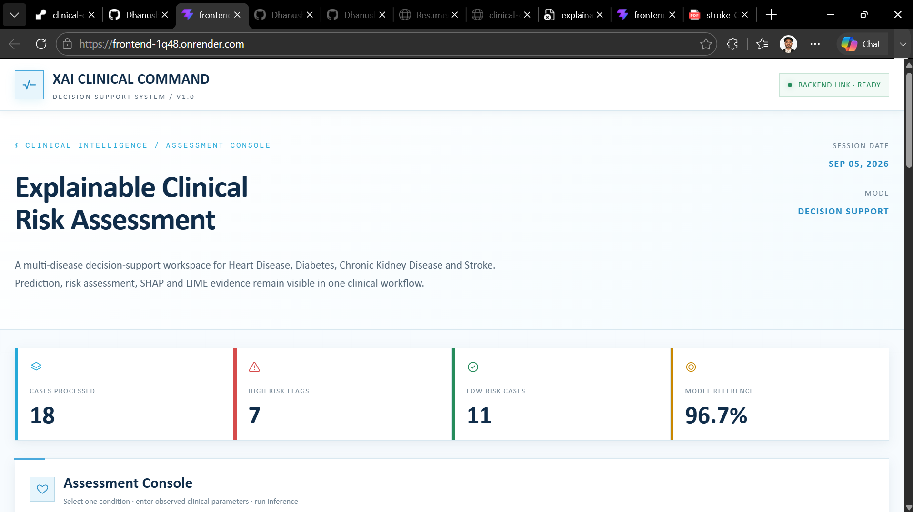

### Diabetes Prediction
Diabetes risk assessment using clinical parameters with model prediction and explainability results.

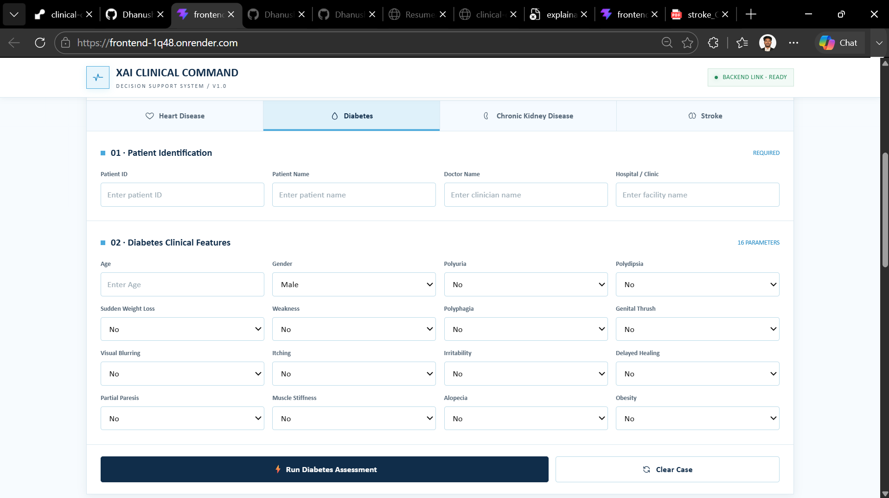

### Heart Disease Prediction
Heart disease assessment with prediction probability, risk classification, and explainable AI outputs.

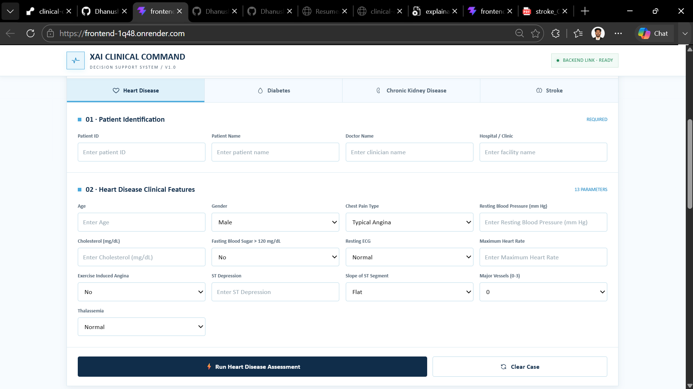

### Chronic Kidney Disease Prediction
CKD risk assessment using patient clinical parameters with prediction and explanation.

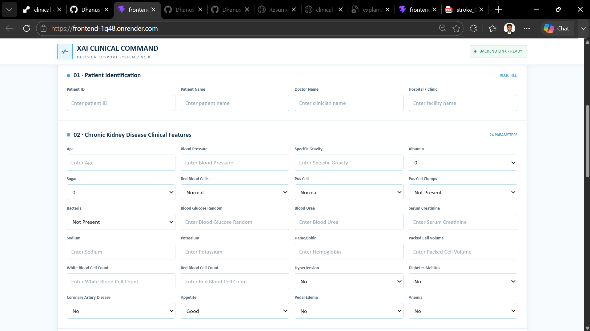

### Stroke Prediction
Stroke risk assessment using demographic and clinical risk factors.

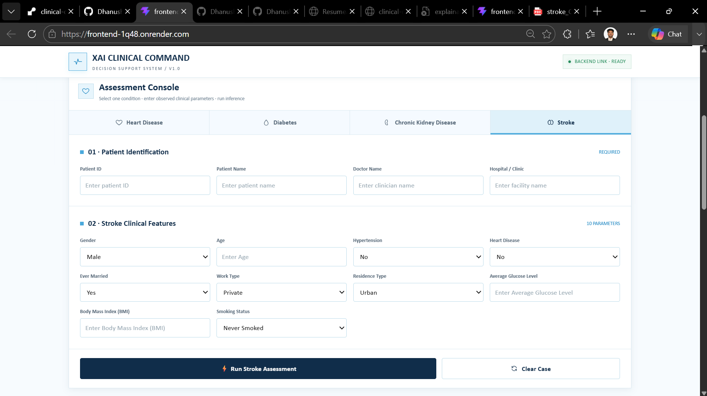

### Prediction History
Previous patient assessments can be viewed through the prediction history interface.

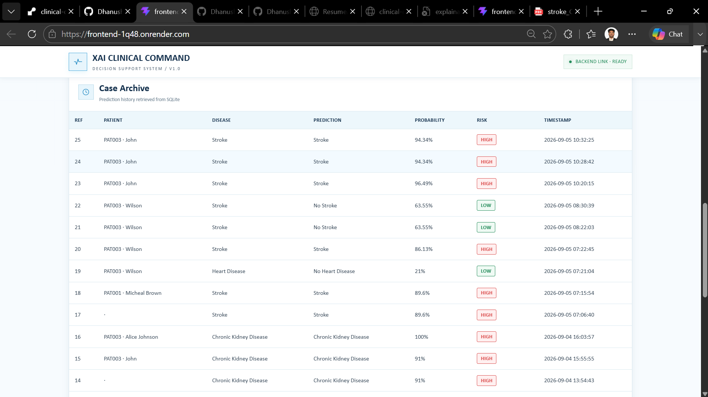

### Clinical Report
The system generates a clinical prediction report containing patient information, prediction results, recommendations, SHAP explanations, and LIME explanations.

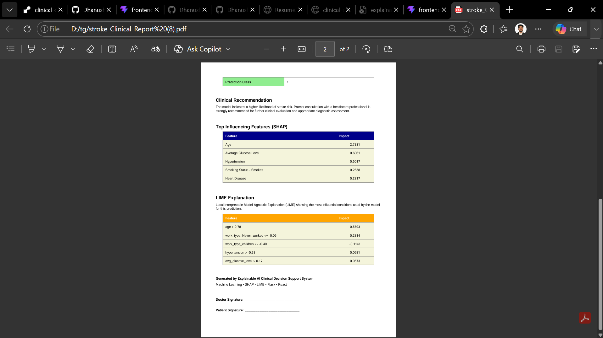
----

# Supported Diseases

| Disease                      | Dataset Size | Selected Model      |
| ---------------------------- | -----------: | ------------------- |
| Heart Disease                |          303 | Random Forest       |
| Diabetes                     |          520 | Decision Tree       |
| Chronic Kidney Disease (CKD) |          400 | Random Forest       |
| Stroke                       |        5,110 | Logistic Regression |

The datasets have different structures, feature types, class distributions, and preprocessing requirements.

Therefore, each disease module has its own preprocessing and model pipeline.

---

# System Architecture

The overall system follows a client-server architecture.

```text
                    +---------------------+
                    |       User          |
                    |   Clinical Inputs   |
                    +----------+----------+
                               |
                               v
                    +---------------------+
                    |   React Frontend    |
                    |                     |
                    | Patient Form        |
                    | Dashboard           |
                    | Prediction Card     |
                    | XAI Visualization   |
                    | History             |
                    +----------+----------+
                               |
                         HTTP / JSON
                               |
                               v
                    +---------------------+
                    |   Flask Backend     |
                    |                     |
                    | Validation          |
                    | Prediction          |
                    | Explainability      |
                    | Recommendation      |
                    | Report Generation   |
                    +----------+----------+
                               |
             +-----------------+-----------------+
             |                 |                 |
             v                 v                 v
      +-------------+   +-------------+   +-------------+
      | ML Models   |   | XAI Engine  |   | SQLite DB   |
      |             |   |             |   |             |
      | Heart       |   | SHAP        |   | History     |
      | Diabetes    |   | LIME        |   | Records     |
      | CKD         |   |             |   |             |
      | Stroke      |   |             |   |             |
      +-------------+   +-------------+   +-------------+
                               |
                               v
                    +---------------------+
                    | Clinical PDF Report |
                    +---------------------+
```

---

# Application Workflow

The complete workflow is:

```text
1. User selects disease
          |
2. User enters patient information
          |
3. Frontend validates input
          |
4. Data is sent to Flask backend
          |
5. Backend validates received data
          |
6. Disease-specific preprocessing
          |
7. Trained ML model generates prediction
          |
8. Prediction probability is calculated
          |
9. Risk level is determined
          |
10. SHAP explanation is generated
          |
11. LIME explanation is generated
          |
12. Clinical recommendation is generated
          |
13. Prediction is stored in database
          |
14. Result is returned to frontend
          |
15. User views prediction and explanation
          |
16. PDF report can be generated
```

---

# Machine Learning Pipeline

Each disease follows a disease-specific ML pipeline.

General workflow:

```text
Raw Dataset
     |
     v
Data Inspection
     |
     v
Missing Value Handling
     |
     v
Categorical Encoding
     |
     v
Train/Test Split
     |
     v
Feature Scaling
     |
     v
Model Training
     |
     v
Model Evaluation
     |
     v
Best Model Selection
     |
     v
Model Serialization
     |
     v
Backend Integration
```

---

# Explainable AI

Explainable Artificial Intelligence is a major component of this project.

The purpose of XAI is to make model predictions more understandable by identifying the contribution of individual input features.

Two major techniques are implemented:

```text
                 XAI
                  |
        +---------+---------+
        |                   |
       SHAP                LIME
        |                   |
 Global + Local          Local
 Explanation            Explanation
```

---

# SHAP

SHAP stands for:

> SHapley Additive exPlanations

SHAP is based on Shapley values from cooperative game theory.

The basic idea is to determine how much each feature contributes to a model prediction.

A simplified interpretation is:

```text
Model Output
=
Base Value
+
Feature Contributions
```

For an individual patient, SHAP can provide values such as:

```text
Age                     +2.723
Average Glucose Level   +0.606
Hypertension            +0.502
Heart Disease           +0.222
BMI                     +0.041
```

A positive contribution generally pushes the model output toward the positive class, while a negative contribution pushes it away from the positive class.

The actual interpretation depends on the model and output representation.

---

# LIME

LIME stands for:

> Local Interpretable Model-agnostic Explanations

LIME explains an individual prediction by creating local perturbations around the input and fitting an interpretable local approximation.

Example:

```text
age > 0.78                         +0.550
hypertension > -0.33              +0.097
avg_glucose_level > 0.17          +0.060
work_type_children <= -0.40       -0.100
```

The LIME explanation is local to the particular patient being evaluated.

---

# SHAP vs LIME

| Property         | SHAP                                       | LIME                                            |
| ---------------- | ------------------------------------------ | ----------------------------------------------- |
| Full Name        | SHapley Additive exPlanations              | Local Interpretable Model-agnostic Explanations |
| Explanation Type | Global + Local                             | Mainly Local                                    |
| Main Purpose     | Feature contribution                       | Local approximation                             |
| Model Dependency | Depends on explainer/model                 | Model-agnostic                                  |
| Output           | Feature contribution values                | Local feature weights                           |
| Use in Project   | Feature importance and patient explanation | Individual patient explanation                  |

Both techniques complement each other in the system.

---

# Disease-wise Machine Learning Details

Each disease has its own dataset and model pipeline.

The system does not force the same algorithm or preprocessing strategy onto every disease.

This is important because:

* datasets have different feature types
* missing values differ
* class distributions differ
* feature representations differ
* model behavior differs

---

# Heart Disease Module

## Dataset

The Heart Disease module uses the UCI Cleveland Heart Disease dataset.

The dataset contains:

* 303 patient records
* 13 predictor features
* Target variable representing heart disease status

The project uses a stratified train-test split.

```text
Total Records: 303

Training: 242
Testing: 61
```

The test size is 20%.

---

## Preprocessing

The heart disease pipeline includes:

1. Feature-target separation
2. Stratified train-test split
3. Feature scaling using StandardScaler
4. Model training
5. Model comparison
6. Best model selection

The scaler is fitted only on training data and then applied to test data.

This helps avoid information leakage from the test set.

---

## Models Evaluated

The following models were evaluated:

* Logistic Regression
* Decision Tree
* Random Forest
* Support Vector Machine
* XGBoost

---

## Selected Heart Disease Model

The selected model is:

> Random Forest

Test results:

| Metric    |  Score |
| --------- | -----: |
| Accuracy  | 88.52% |
| Precision | 81.82% |
| Recall    | 96.43% |
| F1 Score  | 88.52% |
| ROC-AUC   | 0.8912 |

The Random Forest model was selected based on the evaluation results and suitability for the system.

---

# Diabetes Module

## Dataset

The Diabetes module uses the UCI Early Stage Diabetes Risk Prediction dataset.

Dataset size:

```text
520 records
16 input features
1 target variable
```

Class distribution:

```text
Positive: 320
Negative: 200
```

---

## Features

The dataset includes features such as:

* Age
* Gender
* Polyuria
* Polydipsia
* Sudden weight loss
* Weakness
* Polyphagia
* Genital thrush
* Visual blurring
* Itching
* Irritability
* Delayed healing
* Partial paresis
* Muscle stiffness
* Alopecia
* Obesity

---

## Preprocessing

Categorical values were converted into numerical representations.

Examples:

```text
Yes → 1
No  → 0
```

Target:

```text
Negative → 0
Positive → 1
```

The dataset was split using stratification.

```text
Training: 416
Testing: 104
```

StandardScaler was fitted on the training data.

---

## Models Evaluated

* Logistic Regression
* Decision Tree
* Random Forest
* Support Vector Machine
* XGBoost

---

## Selected Diabetes Model

The selected model is:

> Decision Tree

Evaluation:

| Metric    |   Score |
| --------- | ------: |
| Accuracy  |  99.04% |
| Precision | 100.00% |
| Recall    |  98.44% |
| F1 Score  |  99.21% |
| ROC-AUC   |  99.22% |

These values are dataset-specific test results and should not be interpreted as clinical performance.

---

# Chronic Kidney Disease Module

## Dataset

The CKD module uses the UCI Chronic Kidney Disease dataset.

Dataset size:

```text
400 records
24 input features
1 target variable
```

The dataset contains both numerical and categorical features and includes missing values.

---

## Features

Examples include:

* Age
* Blood Pressure
* Specific Gravity
* Albumin
* Sugar
* Red Blood Cells
* Pus Cell
* Pus Cell Clumps
* Bacteria
* Blood Glucose
* Blood Urea
* Serum Creatinine
* Sodium
* Potassium
* Hemoglobin
* Packed Cell Volume
* White Blood Cell Count
* Red Blood Cell Count
* Hypertension
* Diabetes Mellitus
* Coronary Artery Disease
* Appetite
* Pedal Edema
* Anemia

---

## Preprocessing

The CKD preprocessing pipeline includes:

### Missing Values

Missing values represented using `?` are converted to missing values.

### Numerical Features

Numerical missing values are handled using median imputation.

### Categorical Features

Categorical missing values are handled using most-frequent imputation.

### Encoding

Categorical variables are mapped into numerical representations.

### Scaling

StandardScaler is applied after imputation.

---

## Train/Test Split

```text
Training: 319
Testing: 80
```

The split is stratified.

---

## Models Evaluated

* Logistic Regression
* Decision Tree
* Random Forest
* Support Vector Machine
* XGBoost

---

## Selected CKD Model

The selected model is:

> Random Forest

Evaluation:

| Metric    | Score |
| --------- | ----: |
| Accuracy  |  100% |
| Precision |  100% |
| Recall    |  100% |
| F1 Score  |  100% |
| ROC-AUC   |  100% |

XGBoost also achieved the same test performance on this split.

The Random Forest model was selected as the deployed CKD model.

### Important Note

The 100% score is specific to the dataset and the selected train/test split.

It should **not** be interpreted as 100% clinical diagnostic accuracy.

---

# Stroke Module

## Dataset

The Stroke module uses a commonly used Stroke Prediction Dataset containing:

```text
5,110 records
12 original columns
```

The target variable is:

```text
stroke
```

---

## Features

The model uses patient information including:

* Gender
* Age
* Hypertension
* Heart Disease
* Ever Married
* Work Type
* Residence Type
* Average Glucose Level
* BMI
* Smoking Status

The original dataset also contains an `id` column, which is not used as a prediction feature.

---

## Missing Values

The major missing-value issue is BMI.

```text
Missing BMI records: 201
```

Missing numerical values are handled using median imputation fitted on the training data.

---

## Class Imbalance

The stroke dataset is highly imbalanced.

```text
No Stroke: 4,861
Stroke:      249
```

Approximately:

```text
95.13% → No Stroke
4.87%  → Stroke
```

Therefore, accuracy alone is not sufficient for evaluating this model.

The project also considers:

* Precision
* Recall
* F1 Score
* ROC-AUC
* PR-AUC

---

# Stroke Class Imbalance Handling

To address class imbalance, the models use class-weighting or positive-class weighting.

Examples include:

```text
class_weight="balanced"
```

for models such as:

* Logistic Regression
* Decision Tree
* Random Forest
* SVM

XGBoost uses a positive-class weight based on the training class imbalance.

---

# Stroke Models

The following models were evaluated:

* Logistic Regression
* Decision Tree
* Random Forest
* Support Vector Machine
* XGBoost

---

# Stroke Model Results

Default-threshold results include:

| Model               | Accuracy | Precision | Recall |     F1 | ROC-AUC | PR-AUC |
| ------------------- | -------: | --------: | -----: | -----: | ------: | -----: |
| Logistic Regression |   74.66% |    13.84% | 80.00% | 23.60% |  84.38% | 26.82% |
| Decision Tree       |   92.95% |    15.62% | 10.00% | 12.20% |  53.61% |  5.97% |
| Random Forest       |   93.54% |    21.43% | 12.00% | 15.38% |  77.55% | 13.30% |
| SVM                 |   77.20% |    12.35% | 60.00% | 20.48% |       - |      - |
| XGBoost             |   83.95% |    18.68% | 68.00% | 29.31% |  84.25% | 22.86% |

The results demonstrate the difficulty of predicting a minority stroke class in a highly imbalanced dataset.

---

# Selected Stroke Model

The selected final Stroke model is:

> Logistic Regression

The model was selected because it provided:

* strong ROC-AUC
* strong PR-AUC
* competitive recall
* good threshold-based F1 performance
* relatively simple and interpretable behavior

Logistic Regression also works naturally with the project's explainability pipeline using a linear SHAP explainer.

---

# Prediction Threshold

The default probability threshold of 0.5 was not used as the final operational threshold for the Stroke module.

A threshold of:

```text
0.85
```

was selected during the model evaluation process.

The threshold is stored separately:

```text
models/stroke/threshold.pkl
```

The backend uses the stored threshold during prediction.

The prediction logic is conceptually:

```python
if probability >= threshold:
    prediction = 1
else:
    prediction = 0
```

The threshold is an experimental model configuration and has not been clinically validated.

---

# Stroke Example

For a high-risk example patient, the system can produce an output such as:

```text
Prediction: Stroke
Probability: 94.34%
Risk Level: High
Prediction Class: 1
```

The corresponding explanation can identify influential features such as:

```text
Age
Average Glucose Level
Hypertension
Heart Disease
Smoking Status
```

These are model explanations and should not be interpreted as proof of causality.

---

# Clinical Recommendations

The recommendation module generates a general recommendation based on the prediction result.

For example, a higher predicted risk can result in a recommendation similar to:

```text
The model indicates a higher likelihood of stroke risk.
Prompt consultation with a healthcare professional is strongly
recommended for further clinical evaluation and appropriate
diagnostic assessment.
```

The recommendation is intended as a decision-support message.

It is not intended to replace medical diagnosis or professional clinical judgment.

---

# Automated Clinical Reports

The system supports automated PDF report generation.

A generated report can contain:

## Patient Information

* Patient ID
* Patient Name
* Doctor/Clinician
* Hospital
* Disease
* Relevant clinical features

## Prediction

* Predicted class
* Probability
* Risk level

## SHAP Explanation

Top contributing features and their SHAP values.

## LIME Explanation

Local feature conditions and corresponding LIME weights.

## Recommendation

General recommendation based on the model result.

---

# LIME Synchronization

The frontend prediction response contains the LIME explanation.

When the user requests a PDF report, the existing LIME explanation can be sent to the backend.

This ensures that the LIME explanation shown in the frontend and the LIME explanation displayed in the PDF correspond to the same prediction result.

Conceptually:

```text
Frontend Prediction
       |
       +-- Prediction
       +-- SHAP
       +-- LIME
              |
              v
       Report Request
              |
              v
       Existing LIME
              |
              v
        PDF Report
```

This avoids unnecessary differences caused by independently recalculating the explanation.

---

# Prediction History

The backend uses SQLite to maintain prediction records.

The history functionality can store information such as:

* Patient ID
* Patient name
* Disease
* Prediction
* Probability
* Risk level
* Timestamp
* Associated prediction details

The frontend provides a History section for viewing previous prediction records.

---

# Technology Stack

## Frontend

* React
* Vite
* JavaScript
* HTML
* CSS
* Custom Icons
* Responsive UI Components

## Backend

* Python
* Flask
* Flask-CORS
* Pandas
* NumPy
* Scikit-learn
* XGBoost
* SHAP
* LIME

## Database

* SQLite

## Reporting

* ReportLab

## Machine Learning

* Logistic Regression
* Decision Tree
* Random Forest
* Support Vector Machine
* XGBoost

## Development Tools

* Git
* GitHub
* Jupyter Notebook
* Visual Studio Code

---

# Project Structure

```text
Explainable-AI-CDSS/
│
├── backend/
│   │
│   ├── app.py
│   ├── config.py
│   ├── database.py
│   ├── explainability.py
│   ├── lime_explain.py
│   ├── model_loader.py
│   ├── prediction.py
│   ├── recommendation.py
│   ├── report_generator.py
│   ├── dataset_visualization.py
│   │
│   ├── predictions.db
│   │
│   └── reports/
│       └── clinical_report.pdf
│
├── datasets/
│   │
│   ├── raw/
│   │   ├── heart/
│   │   ├── diabetes/
│   │   ├── ckd/
│   │   └── stroke/
│   │
│   └── processed/
│       ├── heart/
│       ├── diabetes/
│       ├── ckd/
│       └── stroke/
│
├── models/
│   │
│   ├── best_model.pkl
│   │
│   ├── diabetes/
│   │   └── best_model.pkl
│   │
│   ├── ckd/
│   │   ├── best_model.pkl
│   │   └── scaler.pkl
│   │
│   └── stroke/
│       ├── best_model.pkl
│       ├── scaler.pkl
│       ├── imputer.pkl
│       ├── feature_names.pkl
│       └── threshold.pkl
│
├── notebooks/
│   │
│   ├── Heart/
│   ├── Diabetes/
│   ├── CKD/
│   └── Stroke/
│
├── frontend/
│   │
│   ├── package.json
│   ├── vite.config.js
│   │
│   └── src/
│       ├── App.jsx
│       ├── main.jsx
│       ├── index.css
│       │
│       ├── components/
│       │   ├── Dashboard.jsx
│       │   ├── FeatureImportance.jsx
│       │   ├── Footer.jsx
│       │   ├── Hero.jsx
│       │   ├── History.jsx
│       │   ├── Navbar.jsx
│       │   ├── PatientForm.jsx
│       │   ├── PatientSummary.jsx
│       │   ├── PredictionCard.jsx
│       │   └── icons.jsx
│       │
│       └── styles/
│
├── README.md
└── .gitignore
```

---

# Backend

The backend is implemented using Flask.

The backend acts as the central processing layer between the frontend and the machine learning models.

Major backend responsibilities include:

### 1. API Handling

Receives requests from the React frontend.

### 2. Validation

Checks the incoming patient data.

### 3. Prediction

Routes the patient data to the appropriate disease model.

### 4. Explainability

Generates SHAP and LIME explanations.

### 5. Recommendation

Generates a general recommendation based on the prediction.

### 6. Database

Stores prediction history.

### 7. Report Generation

Generates PDF clinical reports.

---

# Frontend

The frontend is built using React and Vite.

The interface follows a clean clinical and academic visual design using:

* White background
* Sky-blue accents
* Navy-blue headings
* Black text
* Calibri-based typography
* Clean cards
* Structured patient forms
* Prediction visualization
* Explanation visualization

---

# Frontend Components

Major components include:

### Dashboard

Provides an overview of the system and available disease modules.

### PatientForm

Collects disease-specific patient information.

### PredictionCard

Displays:

* Prediction
* Probability
* Risk level
* Prediction class

### FeatureImportance

Displays explainability information.

### PatientSummary

Displays patient and prediction information.

### History

Displays stored prediction records.

### Navbar

Provides navigation throughout the application.

### Footer

Provides application information.

# Authentication and Role-Based Access Control

The system provides authentication and role-based access control for three user roles:

- **Admin** – User management and system administration
- **Doctor** – Clinical assessment, prediction, XAI explanations, patient history and reports
- **Staff** – Clinical data entry, prediction and clinical reports

## Signup

New users can create an account through the signup page. New accounts are assigned the Staff role by default.

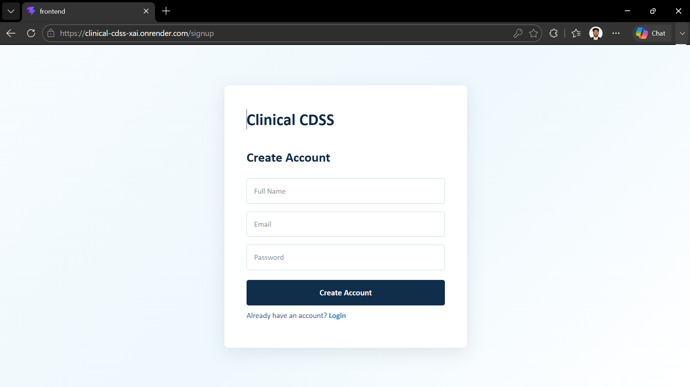

## Admin Login


## Admin Dashboard

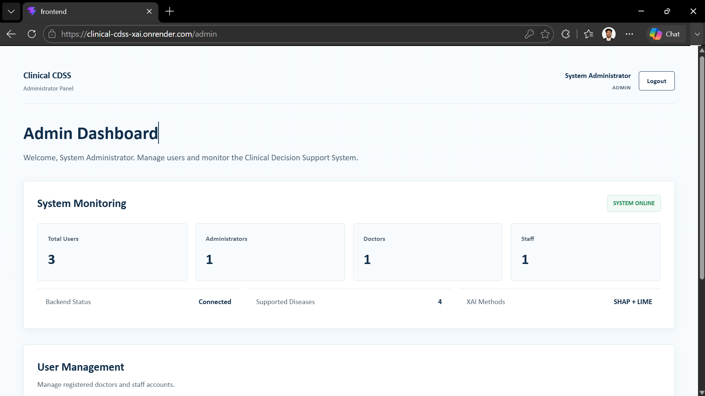

## Admin User Management

Administrators can view registered users and manage their assigned roles.

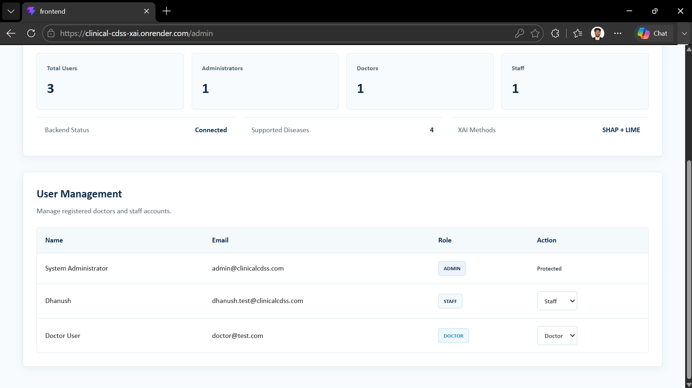

## Doctor Login

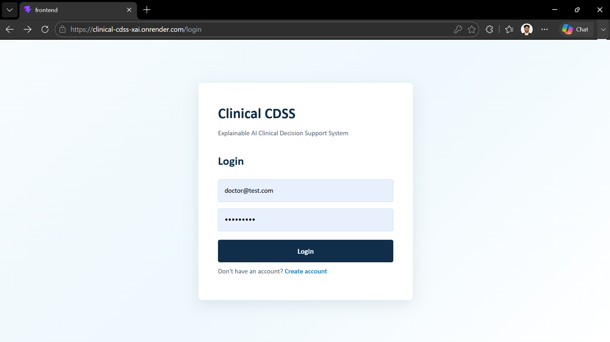

## Doctor Dashboard

Doctors can access clinical decision-support tools, disease prediction, explainable AI results and patient history.

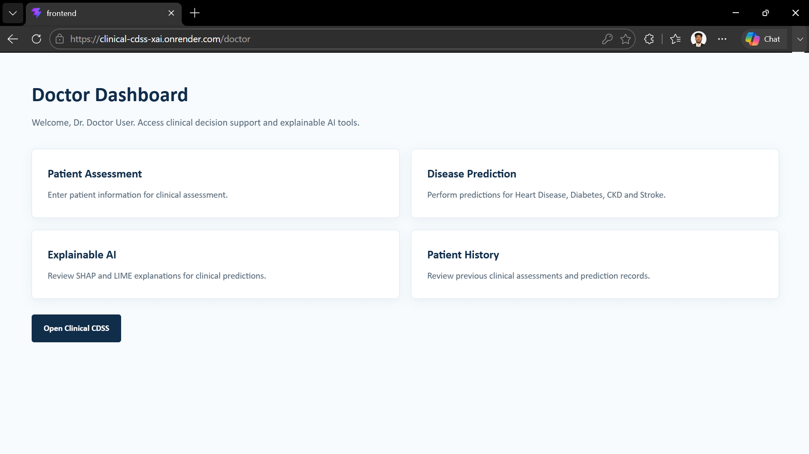

## Doctor Patient History

Doctors can review previous clinical prediction records.

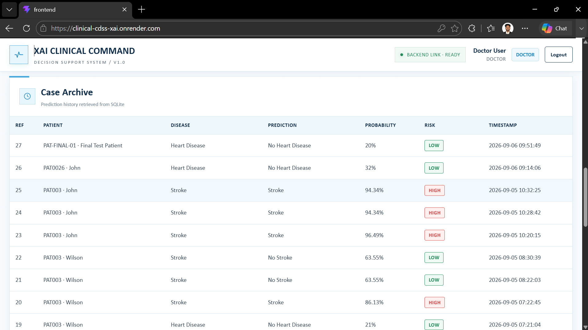

## Doctor Access Control

Role-based access control restricts users to the features permitted for their assigned role.

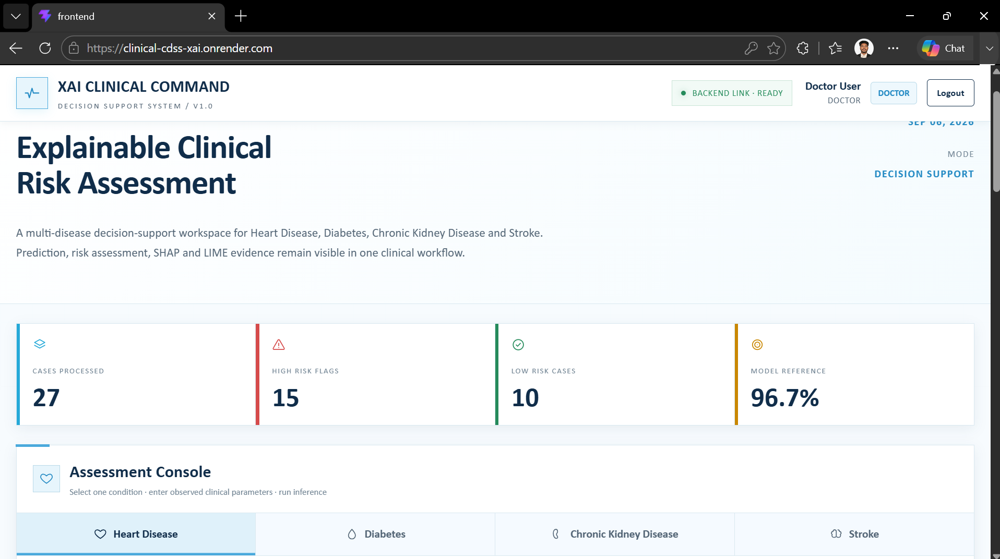

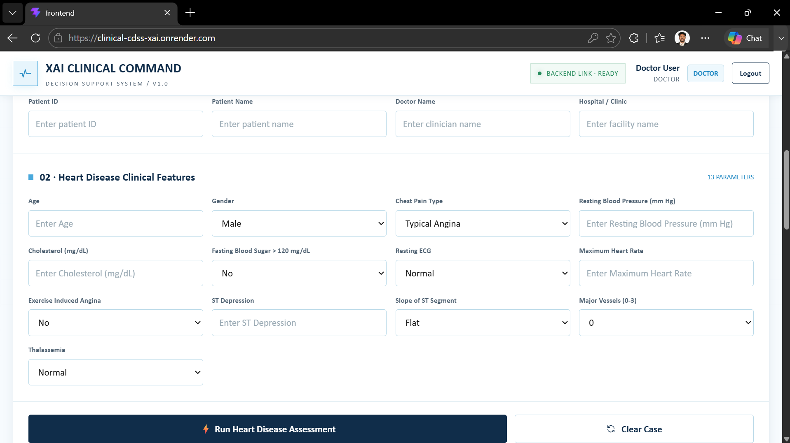

## Staff Login

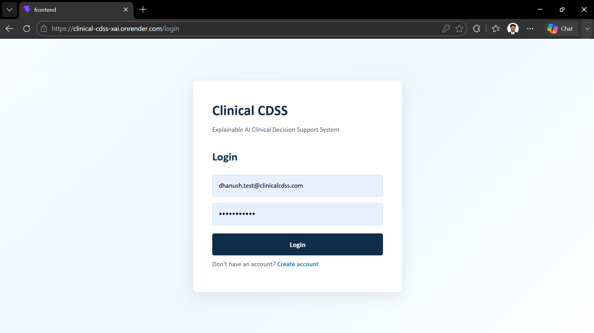

## Staff Dashboard

Staff users can access clinical data entry, prediction and report-related functionality.

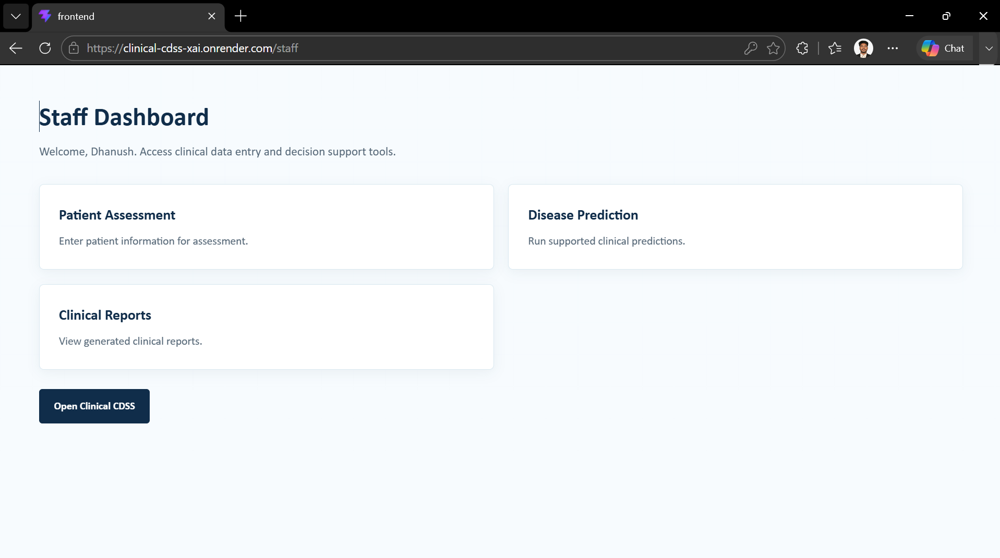

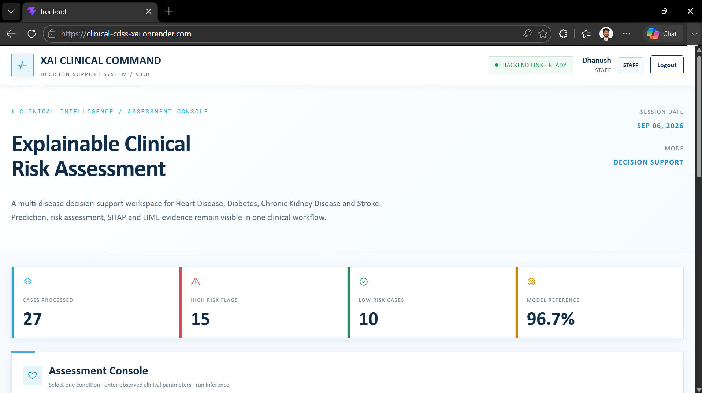

## Staff Access Control

Staff users are restricted from accessing functionality reserved for other roles.

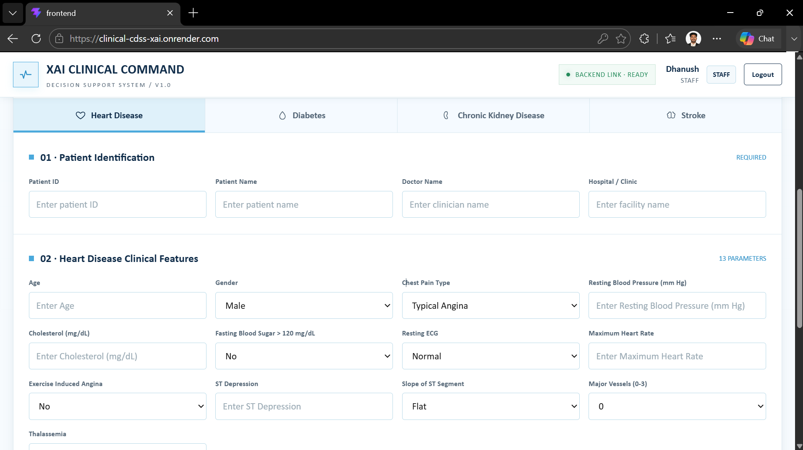

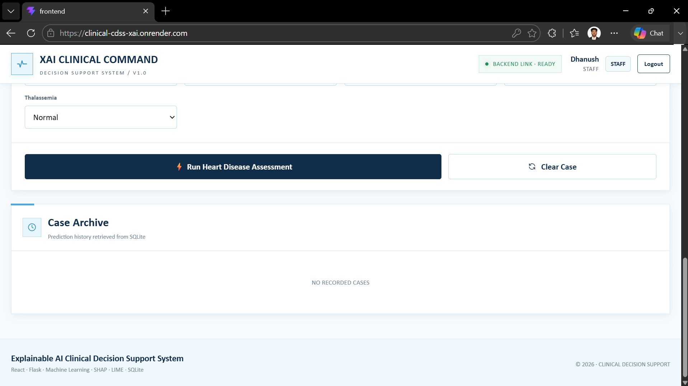
# Database

The system uses SQLite for prediction history.

Database file:

```text
backend/predictions.db
```

SQLite was selected because it is:

* lightweight
* easy to deploy
* suitable for a student-scale application
* serverless
* easy to integrate with Python

For a large production healthcare deployment, a more robust database architecture would be required.

---

# Dataset Information

The project uses publicly available datasets for academic and experimental purposes.

## Heart Disease

UCI Cleveland Heart Disease dataset.

```text
Records: 303
Predictors: 13
```

## Diabetes

UCI Early Stage Diabetes Risk Prediction dataset.

```text
Records: 520
Features: 16
```

## CKD

UCI Chronic Kidney Disease dataset.

```text
Records: 400
Features: 24
```

## Stroke

Stroke Prediction Dataset.

```text
Records: 5,110
Original columns: 12
```

---

# Data Preprocessing

Different preprocessing strategies are applied based on the characteristics of each dataset.

---

## Numerical Features

Numerical values may be:

* converted to numeric format
* imputed when missing
* standardized using StandardScaler

---

## Categorical Features

Categorical variables are encoded using mappings or one-hot encoding depending on the disease module.

For example:

```text
Yes → 1
No → 0
```

Stroke categorical variables use one-hot encoding.

---

## Missing Values

Missing values are handled using training-data-derived imputation.

For example:

```text
Numerical → Median
Categorical → Most Frequent
```

The preprocessing objects are saved and reused during inference.

This is important because the same transformation used during training must be applied during prediction.

---

# Data Leakage Prevention

The preprocessing pipeline is designed so that transformations such as:

* imputation
* scaling

are fitted using training data.

The test data is then transformed using those already-fitted preprocessing objects.

Conceptually:

```text
Training Data
     |
     +-- Fit Imputer
     |
     +-- Fit Scaler
             |
             v
      Saved Preprocessors
             |
             v
       Inference / Test
```

This helps reduce data leakage.

---

# Model Training

Multiple machine learning algorithms were trained and compared for each disease.

The candidate models include:

```text
Logistic Regression
Decision Tree
Random Forest
Support Vector Machine
XGBoost
```

The final model was selected based on the evaluation results and suitability for the specific disease module.

---

# Model Selection Summary

| Disease       | Selected Model      |
| ------------- | ------------------- |
| Heart Disease | Random Forest       |
| Diabetes      | Decision Tree       |
| CKD           | Random Forest       |
| Stroke        | Logistic Regression |

The project intentionally uses different models instead of forcing a single algorithm across all diseases.

---

# Evaluation Metrics

The project uses several evaluation metrics.

## Accuracy

Measures the proportion of correct predictions.

```text
Accuracy =
Correct Predictions / Total Predictions
```

---

## Precision

Measures how many predicted positive cases are actually positive.

```text
Precision =
TP / (TP + FP)
```

---

## Recall

Measures how many actual positive cases were correctly identified.

```text
Recall =
TP / (TP + FN)
```

---

## F1 Score

The harmonic mean of precision and recall.

```text
F1 =
2 × Precision × Recall
----------------------
Precision + Recall
```

---

## ROC-AUC

Measures the ability of a model to distinguish between classes across classification thresholds.

---

## PR-AUC

Precision-Recall AUC is especially useful for imbalanced classification problems such as stroke prediction.

---

# Experimental Results

## Heart Disease

```text
Selected Model: Random Forest

Accuracy:  88.52%
Precision: 81.82%
Recall:    96.43%
F1 Score:  88.52%
ROC-AUC:   0.8912
```

---

## Diabetes

```text
Selected Model: Decision Tree

Accuracy:  99.04%
Precision: 100.00%
Recall:    98.44%
F1 Score:  99.21%
ROC-AUC:   99.22%
```

---

## CKD

```text
Selected Model: Random Forest

Accuracy:  100%
Precision: 100%
Recall:    100%
F1 Score:  100%
ROC-AUC:   100%
```

---

## Stroke

The stroke dataset is highly imbalanced, therefore multiple metrics were considered.

The selected Logistic Regression model achieved:

```text
Accuracy:  74.66%
Precision: 13.84%
Recall:    80.00%
F1 Score:  23.60%
ROC-AUC:   84.38%
PR-AUC:    26.82%
```

These results demonstrate why accuracy alone should not be used to evaluate highly imbalanced medical prediction datasets.

---

# Installation

## Prerequisites

Install the following:

```text
Python 3.x
Node.js
npm
Git
```

Recommended:

```text
Python 3.10+
Node.js 18+
```

---

# Clone the Repository

```bash
git clone https://github.com/Dhanushsj12/Explainable-AI-Clinical-Decision-Support-System.git
```

Move into the project directory:

```bash
cd Explainable-AI-Clinical-Decision-Support-System
```

---

# Backend Setup

Move into the backend directory:

```bash
cd backend
```

Create a virtual environment.

### Windows

```powershell
python -m venv .venv
```

Activate:

```powershell
.venv\Scripts\activate
```

### Linux/macOS

```bash
python3 -m venv .venv
source .venv/bin/activate
```

---

# Install Python Dependencies

Install the required packages:

```bash
pip install flask
pip install flask-cors
pip install pandas
pip install numpy
pip install scikit-learn
pip install xgboost
pip install shap
pip install lime
pip install reportlab
```

Alternatively, if a requirements file is provided:

```bash
pip install -r requirements.txt
```

---

# Frontend Setup

Open a new terminal.

Move to the frontend:

```bash
cd frontend
```

Install dependencies:

```bash
npm install
```

---

# Running the Application

The application requires both the backend and frontend servers.

---

## Start Backend

From:

```text
backend/
```

run:

```bash
python app.py
```

The Flask backend will start locally.

---

## Start Frontend

From:

```text
frontend/
```

run:

```bash
npm run dev
```

Vite will provide the local frontend address in the terminal.

Open that address in a browser.

---

# Using the System

## Step 1 — Open the Application

Open the frontend URL provided by Vite.

---

## Step 2 — Select Disease

Choose one of:

```text
Heart Disease
Diabetes
CKD
Stroke
```

---

## Step 3 — Enter Patient Information

Fill in the required patient information.

For Stroke, for example:

```text
Age
Gender
Hypertension
Heart Disease
Ever Married
Work Type
Residence Type
Average Glucose Level
BMI
Smoking Status
```

---

## Step 4 — Submit Prediction

Click the prediction button.

The frontend sends the patient information to the Flask backend.

---

## Step 5 — View Prediction

The system displays:

```text
Disease
Prediction
Probability
Risk Level
Prediction Class
```

---

## Step 6 — View Explanation

The system displays SHAP and LIME explanations.

---

## Step 7 — View Recommendation

A general recommendation is displayed based on the prediction.

---

## Step 8 — Generate Report

The user can generate a PDF clinical report containing the prediction and explanations.

---

## Step 9 — View History

Previous prediction records can be accessed through the History section.

---

# API Overview

The Flask backend provides endpoints for:

```text
Prediction
Report Generation
History
```

The exact endpoints are implemented in:

```text
backend/app.py
```

---

# Prediction API

The prediction endpoint receives information such as:

```json
{
  "disease": "stroke",
  "features": {
    "gender": "Male",
    "age": 78,
    "hypertension": 1,
    "heart_disease": 1,
    "ever_married": "Yes",
    "work_type": "Private",
    "Residence_type": "Urban",
    "avg_glucose_level": 245.60,
    "bmi": 34.8,
    "smoking_status": "never smoked"
  }
}
```

The backend processes the request and returns the prediction and explanation information.

---

# Stroke Feature Processing

The Stroke backend receives the original patient-level features.

The preprocessing pipeline then:

```text
Raw Patient Data
      |
      v
Numeric Conversion
      |
      v
Missing Value Imputation
      |
      v
Categorical Encoding
      |
      v
Feature Alignment
      |
      v
Scaling
      |
      v
Logistic Regression
      |
      v
Probability
      |
      v
Threshold
      |
      v
Prediction
```

The feature names used during inference are aligned with the saved training feature names.

This prevents feature-order inconsistencies.

---

# Explainability Flow

The explanation process follows:

```text
Patient Input
     |
     v
Same Preprocessing Pipeline
     |
     v
Scaled Features
     |
     +--------------+
     |              |
     v              v
    SHAP           LIME
     |              |
     v              v
Feature            Local
Contributions      Explanation
     |              |
     +-------+------+
             |
             v
       Frontend Result
             |
             v
        PDF Report
```

---

# SHAP Consistency

The SHAP preprocessing pipeline must match the prediction preprocessing pipeline.

For Stroke, both pipelines use:

```text
Numeric Features
+
Categorical Features
+
Imputation
+
One-Hot Encoding
+
Feature Reindexing
+
Scaling
```

This ensures that the SHAP explanation corresponds to the same feature representation used by the prediction model.

---

# Security and Validation

The backend performs validation before processing prediction requests.

The system validates:

* disease selection
* required patient fields
* feature count
* feature types
* numerical conversion
* model availability

The backend also handles errors to prevent invalid requests from crashing the application.

---

# Modular Architecture

One of the main design principles of the project is modularity.

Disease-specific logic is separated into independent components.

Conceptually:

```text
                 Clinical CDSS
                      |
       +--------------+--------------+
       |              |              |
     Heart         Diabetes         CKD
       |              |              |
       +--------------+--------------+
                      |
                    Stroke
```

Each disease can have:

```text
Dataset
Preprocessor
Scaler
Model
SHAP Explainer
LIME Explainer
Recommendation
```

This makes the architecture extensible.

---

# Advantages of the System

## 1. Multi-Disease Support

Multiple disease models are available through one interface.

## 2. Explainability

Predictions are accompanied by feature-level explanations.

## 3. Modular Design

Disease modules can be independently updated.

## 4. User-Friendly Interface

The React frontend provides a structured clinical interface.

## 5. Automated Reports

Clinical-style PDF reports can be generated.

## 6. Prediction History

Previous predictions can be stored and reviewed.

## 7. Model Comparison

Multiple ML algorithms were evaluated before selecting the final models.

## 8. Imbalance Awareness

The Stroke module considers metrics beyond accuracy.

---

# Academic Contribution

The project focuses on the integration of multiple components into a single explainable clinical decision-support workflow.

The primary contribution is a:

> Modular multi-disease clinical decision support system integrating machine learning predictions, SHAP/LIME explanations, recommendations, prediction history, and automated clinical reports.

The project does not claim to introduce a fundamentally new machine learning algorithm.

Instead, the contribution is primarily at the **system and integration level**, with emphasis on:

* modularity
* explainability
* multi-disease support
* consistent preprocessing
* prediction-to-report integration
* clinical-style presentation

---

# Testing

Testing includes:

## Model Testing

Evaluation using:

* Accuracy
* Precision
* Recall
* F1 Score
* ROC-AUC
* PR-AUC

## Backend Testing

Testing:

* prediction endpoints
* validation
* model loading
* XAI generation
* report generation
* database storage

## Frontend Testing

Testing:

* patient form
* disease selection
* prediction display
* XAI display
* history
* PDF generation

## Integration Testing

Testing the complete workflow:

```text
Frontend
   |
   v
Backend
   |
   v
Model
   |
   v
SHAP
   |
   v
LIME
   |
   v
Database
   |
   v
Report
   |
   v
Frontend
```

---

# Limitations

Several limitations should be considered.

## 1. Public Datasets

The models are trained using publicly available datasets and are not trained on a hospital's proprietary clinical population.

## 2. Dataset Size

Some disease datasets are relatively small.

For example:

```text
Heart Disease: 303
Diabetes: 520
CKD: 400
```

Therefore, model performance may vary on unseen real-world populations.

## 3. Dataset Bias

Public datasets may contain demographic, geographic, collection-method, and sampling biases.

## 4. Stroke Class Imbalance

The Stroke dataset contains significantly fewer positive stroke cases than negative cases.

This makes stroke prediction challenging.

## 5. Threshold Selection

The Stroke threshold of 0.85 was selected during model evaluation.

It is not a clinically validated threshold.

## 6. Single Train/Test Split

The reported results are based on the implemented train/test evaluation rather than extensive external validation.

Cross-validation and independent external validation would provide stronger evidence.

## 7. No Clinical Validation

The system has not been validated in a real clinical environment.

## 8. Explainability Does Not Mean Causality

A feature with a high SHAP or LIME contribution does not necessarily mean that the feature caused the disease.

The explanations describe model behavior, not biological causation.

## 9. Probability Is Not Clinical Probability

The model's predicted probability should not automatically be interpreted as a clinically calibrated probability of disease.

---

# Future Enhancements

Future versions could include:

## 1. More Diseases

Additional modules could be added for:

* Liver Disease
* Lung Disease
* Breast Cancer
* Alzheimer's Disease
* Parkinson's Disease
* Other clinical risk prediction tasks

## 2. Deep Learning

Deep learning models could be incorporated for suitable datasets.

## 3. Medical Imaging

The system could be extended to support:

* X-rays
* MRI
* CT scans
* Retinal images

with image-based explainability methods.

## 4. Advanced XAI

Additional techniques could be explored:

* Integrated Gradients
* Grad-CAM
* Counterfactual explanations
* Partial Dependence Plots
* Anchors

## 5. External Validation

Future versions should evaluate models using independent datasets from different populations.

## 6. Cross-Validation

Instead of relying primarily on a single train/test split, future experiments could use:

```text
K-Fold Cross Validation
Stratified K-Fold
Nested Cross Validation
```

## 7. Model Calibration

Probability calibration could be investigated to make predicted probabilities more reliable.

## 8. Authentication

A production-oriented version could introduce:

* User authentication
* Role-based access
* Clinician accounts
* Administrator accounts

## 9. Secure Deployment

Future versions could include:

* HTTPS
* secure database infrastructure
* encrypted sensitive data
* access control
* audit logging

## 10. Cloud Deployment

The system could be deployed using cloud services such as:

```text
Azure
AWS
Google Cloud
```

## 11. Electronic Health Record Integration

Future versions could integrate with healthcare information systems using appropriate healthcare interoperability standards.

---

# Important Clinical Disclaimer

This project is an **academic and research-oriented prototype**.

It is designed to demonstrate:

* Machine Learning
* Explainable AI
* Clinical Decision Support
* Web Application Development
* Model integration
* Prediction reporting

The predictions generated by this system should **not** be considered medical diagnoses.

The system does not replace:

* doctors
* clinicians
* laboratory tests
* medical imaging
* professional diagnosis
* clinical judgment

Any real-world medical decision must be made by a qualified healthcare professional using appropriate clinical information.

---

# Reproducibility

The project stores trained model artifacts and preprocessing components so that the backend can reproduce the preprocessing and inference pipeline used during development.

Examples include:

```text
best_model.pkl
scaler.pkl
imputer.pkl
feature_names.pkl
threshold.pkl
```

The same preprocessing logic used during training should be used during inference.

This is particularly important for:

* feature order
* categorical encoding
* scaling
* missing-value handling

---

# Model Artifact Management

The model directory contains disease-specific model artifacts.

Example:

```text
models/
|
+-- best_model.pkl
|
+-- diabetes/
|   +-- best_model.pkl
|
+-- ckd/
|   +-- best_model.pkl
|   +-- scaler.pkl
|
+-- stroke/
    +-- best_model.pkl
    +-- scaler.pkl
    +-- imputer.pkl
    +-- feature_names.pkl
    +-- threshold.pkl
```

These files allow the backend to load the trained models without retraining them every time the application starts.

---

# Development Workflow

The development process follows:

```text
Literature Survey
       |
       v
Dataset Selection
       |
       v
Data Exploration
       |
       v
Preprocessing
       |
       v
Model Training
       |
       v
Model Comparison
       |
       v
Model Selection
       |
       v
XAI Integration
       |
       v
Backend Development
       |
       v
Frontend Development
       |
       v
Database Integration
       |
       v
Report Generation
       |
       v
System Testing
       |
       v
Final Integration
```

---

# Why Explainability Matters

Traditional ML:

```text
Patient Data
     |
     v
ML Model
     |
     v
Prediction
```

Explainable ML:

```text
Patient Data
     |
     v
ML Model
     |
     v
Prediction
     |
     +-- SHAP
     |
     +-- LIME
             |
             v
      Feature Explanation
```

This additional information can help users understand how the model reached its prediction.

However, the explanations should be interpreted as explanations of the model's behavior rather than as medical reasoning or causal evidence.

---

# Project Design Principles

The system follows several important design principles.

## Modularity

Disease-specific logic is separated.

## Explainability

Predictions are accompanied by interpretable feature information.

## Reproducibility

Preprocessing and model artifacts are stored.

## Consistency

Prediction and explanation pipelines use compatible feature transformations.

## Extensibility

New disease modules can be added in the future.

## Usability

The frontend presents information in a structured manner.

---

# Future System Architecture

The current architecture can be extended as:

```text
                         Clinical CDSS
                              |
             +----------------+----------------+
             |                |                |
             v                v                v
        Disease Models     XAI Engine       Database
             |                |                |
      +------+-----+      +---+----+           |
      |      |     |      |        |           |
    Heart Diabetes CKD   SHAP     LIME       History
      |      |     |      |        |
      +------+-----+      +---+----+
             |
           Stroke
             |
             +------------------+
                                |
                                v
                        Clinical Report
```

---

# Example End-to-End Prediction

Example Stroke input:

```text
Patient ID: PAT003
Age: 78
Gender: Male
Hypertension: Yes
Heart Disease: Yes
Ever Married: Yes
Work Type: Private
Residence Type: Urban
Average Glucose Level: 245.60
BMI: 34.8
Smoking Status: never smoked
```

Example system output:

```text
Prediction: Stroke
Probability: 94.34%
Risk Level: High
Prediction Class: 1
```

Example SHAP explanation:

```text
Age                     +2.723
Average Glucose Level   +0.606
Hypertension            +0.502
Heart Disease           +0.222
Work Type - Children    -0.159
```

Example LIME explanation:

```text
age > 0.78                       +0.550
work_type_children <= -0.40     -0.100
hypertension > -0.33            +0.097
work_type_Self-employed <= ...  +0.063
avg_glucose_level > 0.17        +0.060
```

The exact values can vary depending on the patient input.

---

# Conclusion

The **Explainable AI Clinical Decision Support System** demonstrates how Machine Learning and Explainable AI can be integrated into a modular multi-disease healthcare application.

The system currently supports:

```text
Heart Disease
Diabetes
Chronic Kidney Disease
Stroke
```

Each disease uses a dedicated machine learning pipeline with appropriate preprocessing and model selection.

The system goes beyond simple prediction by integrating:

```text
Machine Learning
       +
SHAP
       +
LIME
       +
Risk Assessment
       +
Clinical Recommendation
       +
Prediction History
       +
PDF Report Generation
```

The primary focus of the project is to demonstrate an explainable, modular, and user-friendly clinical decision-support workflow.

The system is intended as an academic prototype and should not be used as a substitute for professional medical diagnosis or clinical judgment.

---

# Author

**Dhanush S.J.**

School of Computer Science Engineering and Information Systems
Department of Software and Systems Engineering
VIT University

### Project Title

**Explainable AI for Clinical Diagnosis: XAI-Enhanced Decision Support System**

### Domain

```text
Artificial Intelligence
Machine Learning
Explainable AI
Clinical Decision Support Systems
Healthcare Informatics
```

---

# Repository

**GitHub Repository:**

[https://github.com/Dhanushsj12/Explainable-AI-Clinical-Decision-Support-System](https://github.com/Dhanushsj12/Explainable-AI-Clinical-Decision-Support-System)

---

# Keywords

```text
Artificial Intelligence
Machine Learning
Explainable AI
XAI
Clinical Decision Support System
CDSS
Healthcare AI
Medical AI
Disease Prediction
Heart Disease Prediction
Diabetes Prediction
Chronic Kidney Disease Prediction
Stroke Prediction
SHAP
LIME
Random Forest
Decision Tree
Logistic Regression
XGBoost
Flask
React
Python
SQLite
Clinical Reports
```

---

## Disclaimer

This repository is intended for educational, academic, and research purposes only.

It does not provide medical advice, diagnosis, treatment recommendations, or clinical decisions.

Always consult a qualified healthcare professional for medical evaluation and diagnosis.

```
```
