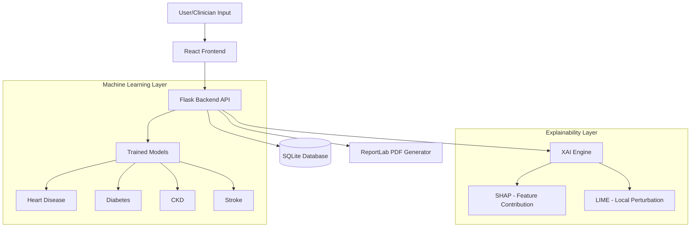

Here is a completely revamped, professional, and visually appealing `README.md` for your GitHub repository. It includes modern formatting, badges, organized sections, and clearly defined placeholders for your screenshots. 

You can just copy the entire block below and paste it into your `README.md` file.

```markdown
<div align="center">

# 🏥 Explainable AI Clinical Decision Support System (XAI-CDSS)

**A modular, multi-disease predictive healthcare system powered by Machine Learning and Explainable AI (SHAP & LIME).**

[](https://clinical-cdss-xai.onrender.com/)
[](https://github.com/Dhanushsj12/Explainable-AI-Clinical-Decision-Support-System)

[](#)
[](#)
[](#)
[](#)

</div>

---

## 📖 Overview

Healthcare applications increasingly use Machine Learning for risk assessment, but conventional models operate as "black boxes." **A prediction is only useful when the reasoning behind it is understood.** 

This project is an **Explainable Artificial Intelligence (XAI) based Clinical Decision Support System** capable of predicting multiple diseases while providing transparent, feature-level explanations for every prediction. It integrates ML, XAI, clinical recommendations, and automated PDF report generation into a single, modular web application.

---

## ✨ Key Features

- **🩺 Multi-Disease Prediction:** Support for Heart Disease, Diabetes, Chronic Kidney Disease (CKD), and Stroke.
- **🧠 Explainable AI (XAI):** Uses **SHAP** (Global/Local) and **LIME** (Local) to explain exactly *why* a model made a specific prediction.
- **📊 Risk Assessment:** Converts model probabilities into actionable clinical risk levels (Low, Moderate, High).
- **📄 Automated Clinical Reports:** Generates structured, downloadable PDF reports containing patient info, predictions, and visual XAI explanations.
- **🔐 Role-Based Access Control (RBAC):** Dedicated dashboards and workflows for **Admins**, **Doctors**, and **Staff**.
- **📂 Patient History Tracking:** Built-in SQLite database to log and review previous prediction records.

---

## 📸 System Interface & Screenshots

*(Note: Replace the image paths in the brackets with your actual image paths once uploaded)*

| Feature | Screenshot Placeholder |
| :--- | :--- |
| **Main Dashboard**<br>Overview of the system and available disease modules. | `` |
| **Heart Disease Module**<br>Assessment with prediction probability, risk classification, and XAI outputs. | `` |
| **Diabetes Module**<br>Diabetes risk assessment and clinical parameters. | `` |
| **Chronic Kidney Disease (CKD)**<br>Risk assessment using 24 patient clinical parameters. | `` |
| **Stroke Module**<br>Stroke risk assessment with advanced class-imbalance handling. | `` |
| **Prediction History**<br>Database view for doctors to review previous patient assessments. | `` |
| **Automated PDF Report**<br>Exported clinical report with embedded SHAP and LIME visualizations. | `` |
| **Role-Based Access (Admin/Doctor)**<br>Secure login and specialized dashboards based on user roles. | `` |

---

## 🔬 Supported Diseases & ML Models

The system is highly modular. Because medical datasets vary wildly in structure and class balance, each disease utilizes its own customized ML pipeline and evaluation metrics.

| Disease | Dataset Size | Selected Model | Target Metrics (Test Split) |
| :--- | :---: | :--- | :--- |
| **❤️ Heart Disease** | 303 | Random Forest | Accuracy: 88.52%, ROC-AUC: 0.89 |
| **🩸 Diabetes** | 520 | Decision Tree | Accuracy: 99.04%, ROC-AUC: 0.99 |
| **🧪 CKD** | 400 | Random Forest | Accuracy: 100%, ROC-AUC: 1.00* |
| **🧠 Stroke** | 5,110 | Logistic Regression | Imbalanced Data Handling (PR-AUC focused) |

*\*Note: 100% scores are specific to the dataset/split and do not reflect real-world clinical diagnostic accuracy.*

---

## 🏗️ System Architecture



---

## 🛠️ Technology Stack

- **Frontend:** React, Vite, HTML/CSS, JavaScript
- **Backend:** Python, Flask, Flask-CORS
- **Machine Learning:** Scikit-learn, XGBoost, Pandas, NumPy
- **Explainability (XAI):** SHAP, LIME
- **Database:** SQLite
- **PDF Generation:** ReportLab
- **Deployment:** Render (Live Demo)

---

## 🚀 Installation & Setup

### Prerequisites
- Python 3.10+
- Node.js 18+
- Git

### 1. Clone the Repository
```bash
git clone https://github.com/Dhanushsj12/Explainable-AI-Clinical-Decision-Support-System.git
cd Explainable-AI-Clinical-Decision-Support-System
```

### 2. Backend Setup
Open a terminal and navigate to the backend directory:
```bash
cd backend
# Create and activate virtual environment
python -m venv .venv
# Windows:
.venv\Scripts\activate
# Linux/macOS:
source .venv/bin/activate

# Install dependencies
pip install -r requirements.txt
# (or pip install flask flask-cors pandas numpy scikit-learn xgboost shap lime reportlab)

# Start the Flask server
python app.py
```

### 3. Frontend Setup
Open a new terminal and navigate to the frontend directory:
```bash
cd frontend

# Install Node dependencies
npm install

# Start the Vite development server
npm run dev
```
Navigate to the local URL provided by Vite (usually `http://localhost:5173`) in your web browser.

---

## 🔒 Security & Role-Based Access

The system enforces authentication and routing based on 3 primary roles:
1. **Admin:** System administration, user role management, system oversight.
2. **Doctor:** Full access to clinical assessments, predictions, XAI results, patient history, and report generation.
3. **Staff:** Restricted access to clinical data entry and standard report generation.

---

## ⚠️ Important Clinical Disclaimer

This project is an **academic and research-oriented prototype**. It is designed to demonstrate the integration of Machine Learning and Explainable AI in web applications.

**The predictions generated by this system should NOT be considered medical diagnoses.** 
This system does not replace doctors, clinicians, laboratory tests, professional medical diagnosis, or clinical judgment. Any real-world medical decision must be made by a qualified healthcare professional.

---

## 👨‍💻 Author

**Dhanush S.J.**  
*School of Computer Science Engineering and Information Systems*  
*Department of Software and Systems Engineering*  
*VIT University*  

**Project Title:** Explainable AI for Clinical Diagnosis: XAI-Enhanced Decision Support System

---

<div align="center">
<i>If you found this repository useful, please consider giving it a ⭐!</i>
</div>
```
